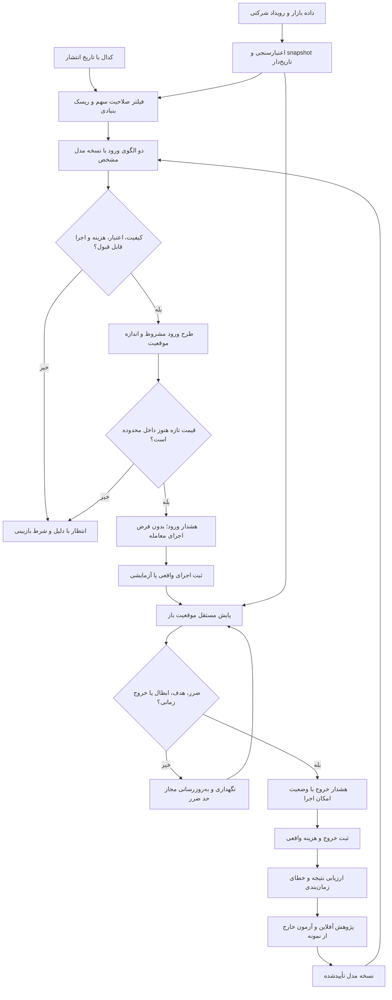

# ممیزی SMART و دستورالعمل بهبود ورود و خروج

تاریخ: ۱۰ اکتبر ۲۰۲۶. دامنه: کد محلی فعلی، قرارداد API، مسیر تصمیم و تست‌ها.
این بررسی شامل اتصال زنده به بورس، مشاهده تصویری مرورگر یا اثبات سودآوری نیست.
تغییرات ثبت‌نشده نوبت‌های قبل نیز در نسخه بررسی‌شده حضور دارند.

آزمون مستقل این نوبت: `python -m pytest -q` → **۲۳۰ موفق، یک شکست، یک
غیرفعال در ۶۳٫۵۱ ثانیه**. شکست همان رگرسیون ردیف تاریخی صفر در جدول زیر
است. بنابراین نسخه فعلی از دروازه پذیرش «تمام تست‌ها موفق» عبور نمی‌کند.

## نتیجه اصلی

SMART اکنون بیشتر یک سامانه پژوهش و گزارش است تا سامانه پایش ورود و خروج.
منطق چندعاملی، ذخیره شواهد، کنترل داده و بازپخش موجود است؛ اما مسیر اصلی
شرط‌های دائماً تأییدنشده دارد و خروج به دفتر موقعیت و پایش متصل نیست.
هدف توسعه باید «تصمیم قابل اجرا، تاریخ‌دار و قابل سنجش» باشد؛ نه تولید
سیگنال در هر شرایط یا ادعای تشخیص قطعی کف و سقف.

## یافته‌ها و شاهد کد

| شدت | یافته | شاهد | پیامد و اقدام |
|---|---|---|---|
| بحرانی | خرید در مسیر یکپارچه عملاً دست‌نیافتنی است | `unified_analysis.py`: `model_policy.approved=False`؛ `data_quality_gate.py`: تعدیل همواره UNVERIFIED؛ `setup_state.py`: نقدشوندگی و گپ همواره UNVERIFIED؛ `final_decision.py`: همه اجباری | مسیر تأیید نسخه مدل و شواهد اجرای معامله بسازید؛ با True کردن ثابت یا حذف گیت، مسئله را پنهان نکنید |
| بحرانی | خروج پایش و ذخیره نمی‌شود | `webapp.py`: `/api/risk/review-position` بدون ذخیره؛ `position_review.py`: قیمت ورود و تعداد جلسات از ورودی | دفتر موقعیت، ثبت اجرای واقعی/آزمایشی، پایش مستقل و هشدار لازم است؛ متن برنامه خروج کافی نیست |
| زیاد | بک‌تست همان موتور ورود جدید را آزمون نمی‌کند | `symbol_learning.py`: قواعد `_open_trade` و configuration مستقل؛ `trade_plan.py`: EntryExitEngine مستقل | موفقیت مدل تاریخی، اعتبار شکست/بازآزمایی یا اصلاح فعلی را ثابت نمی‌کند؛ یک قرارداد تصمیم مشترک برای replay و live لازم است |
| زیاد | یک رگرسیون شناخته‌شده در مرز اعتبارسنجی | `test_fund_financial.py::test_zero_ohlc_suspended_rows_are_excluded_without_filling`؛ `conditional_levels.py` دیگر ردیف تاریخی صفر را حذف نمی‌کند | سیاست ردیف تاریخی نامعتبر با کندل آخر نامعتبر جدا شود؛ تمام مصرف‌کنندگان باید همان canonical و audit را بگیرند؛ صرفاً ضعیف‌کردن تست مجاز نیست |
| زیاد | زمان‌بندی روزانه با خروج به‌موقع یکی نیست | EntryExitEngine فقط 1d؛ unified فقط جلسه کامل؛ API خروج وابسته به کندل کامل | فعلاً محصول را تحلیل پایان‌روز معرفی کنید؛ برای هشدار حین جلسه، داده تازه و مسیر پایش مستقل لازم است |
| زیاد | ضرایب هزینه و حجم در چند مسیر یکسان نیستند | `analysis_engine.json`: قابل تنظیم؛ `unified_analysis.py`: هزینه بک‌تست ثابت ۰٫۳۵؛ `final_decision.py`: حجم ثابت ۱٫۲؛ StockAnalysisService از policy پیش‌فرض استفاده می‌کند | یک policy نسخه‌دار به همه مصرف‌کنندگان تزریق و در artifact ثبت شود؛ هزینه پیش‌فرض فرض پژوهشی است، نه تعرفه رسمی تأییدشده |
| زیاد | هدف‌گذاری به تنهایی صلاحیت معامله را ثابت نمی‌کند | `build_plan`: هدف از مضرب ریسک ساخته می‌شود و فقط با pivot مشاهده‌شده سقف می‌گیرد | نسبت ۲ یا ۳ از فرمول حاصل می‌شود، نه احتمال رسیدن؛ توزیع MFE/MAE و نرخ رسیدن به هدف در OOS سنجیده شود؛ مقاومت در تاریخچه بلندتر بررسی شود |
| زیاد | ابطال پیش از ورود فقط close را بررسی می‌کند | `setup_state.py`: `last_close <= stop`، درحالی‌که متن طرح لمس قیمت را ابطال می‌داند | تست کندلی که low حد ضرر را می‌شکند و close برمی‌گردد اضافه شود؛ قاعده لمس، قیمت بسته‌شدن و زمان تولید طرح صریح شوند |
| متوسط | برچسب EXPIRED دو مفهوم دارد | `setup_state.py`: هم پایان مهلت و هم عبور قیمت از محدوده | انقضای زمانی از EXTENDED یا نیاز به بازتأیید جدا شود؛ برگشت قیمت پس از جهش نباید خودکار مجوز ورود شود |
| متوسط | دوره اعتبار و نگهداری به تقویم و اجرای واقعی وصل نیست | اعتبار هفت روز تقویمی؛ holding_sessions از کاربر | سیاست تعطیلی/توقف و شمارش جلسات پس از اجرای واقعی تعریف شود؛ تعطیلی با داده گمشده یا توقف اشتباه نشود |
| متوسط | پژوهش سنگین داخل درخواست تحلیل است | `unified_analysis.py`: آزمون ۲۰۰ استراتژی و profile پیش از entry_exit؛ دریافت history و analyze_symbol جدا | مسیر سریع روی مدل تأییدشده و snapshot واحد کار کند؛ پژوهش و بازآموزی خارج از مسیر هشدار اجرا شوند |
| متوسط | نمایش همه اعداد بدون اعشار | `dashboard.js`: maximumFractionDigits=0 و roundedJSON | قیمت با گام مجاز، نسبت ریسک با دو رقم و هزینه با دقت مناسب نمایش داده شود؛ اطلاعات ماشین گرد نشود |
| متوسط | اطلاعات UI بیش از هدف اصلی است | داشبورد ۱۰ روش مستقل و لایه‌های متعدد | صفحه اصلی فقط وضعیت اقدام، قیمت‌ها، اعتبار، ریسک و دلیل مانع را نشان دهد؛ پژوهش در جزئیات بماند |

## چارت معماری مطلوب

حلقه موقعیت باز نباید به موفقیت کدال یا پایان بک‌تست وابسته باشد. قطع
بنیادی نباید رسیدگی به حد ضرر موقعیت موجود را متوقف کند. هشدار و اجرا
دو رویداد متفاوت‌اند؛ سامانه نباید معامله فرضی را واقعی ثبت کند.

## دستورالعمل اجرایی به ترتیب وابستگی

### مرحله ۱ — تثبیت قرارداد و رفع خطای موجود (P0)

۱. داده خام، canonical معتبر و علت رد هر ردیف را فقط یک‌بار تولید کنید.
۲. داده تاریخی نامعتبر را از داده آخر نامعتبر جدا کنید؛ کندل آخر خراب
حتماً ورود را متوقف کند و حذف‌های تاریخی با کفایت پنجره مدل سنجیده شوند.
۳. تمام تنظیمات ورود، هزینه، حجم و خروج از یک policy نسخه‌دار خوانده شوند.
۴. هر طرح `signal_time`، `data_as_of`، `model_version`، محدوده ورود،
حد ضرر، اهداف، مهلت و شروط ابطال داشته باشد.
۵. تست‌ها باید سبز شوند؛ آزمون‌های آینده‌نگری، NaN، دوباره‌کاری رویداد و
مرز جلسه اضافه شوند. گزارش‌های تاریخی تغییر نکنند.

پذیرش: یک snapshot یکسان در API، replay و موتور تصمیم، طرح یکسان بدهد؛
تغییر هزینه در همه مسیرها اثر یکسان داشته باشد.

### مرحله ۲ — یکسان‌سازی موتور زنده و آزمون (P0)

فقط شکست/بازآزمایی و اصلاح در روند صعودی در نسخه اول ارزیابی شوند.
بک‌تست باید خود همین generator و lifecycle را با اطلاعات تا زمان T صدا بزند.
قواعد ورود جلسه بعد، گپ، صف، لغزش، اهداف مرحله‌ای و تغییر حد ضرر یکسان باشند.
تقسیم train/validation/test زمانی باشد؛ گزینش مدل با test انجام نشود.
اعلام‌های بنیادی بر اساس تاریخ انتشار و نسخه همان زمان فیلتر شوند.

پذیرش: رویدادهای نمونه با جواب دستی معلوم، تست ثبات پیشوند، و برابری
تصمیم live/replay. نتیجه مدل پژوهشی متفاوت، مجوز تأیید موتور اصلی نیست.

### مرحله ۳ — بازکردن مسیر تأیید بر پایه شواهد (P0)

برای هر گیت، تولیدکننده شواهد، تاریخ اعتبار و دلیل شکست مشخص کنید.
تعدیل فقط از رویداد قابل اتکا؛ نقدشوندگی از داده مشاهده‌شده؛ مدل از registry
نسخه‌دار و نتیجه آزمون. امکان پژوهشی، paper و live-ready وضعیت‌های مجزا باشند.
معیار پذیرش پیش از دیدن test ثبت شود. گیت ناممکن یا نامتناسب باید با
تصمیم معماری و تست اصلاح شود، نه تغییر ثابت‌های False به True.

پذیرش: هم سناریوی کامل معتبر به مجوز آزمایشی برسد، هم حذف هر شاهد ضروری
آن را مسدود کند. هر تأیید قابل ردیابی به مدرک باشد.

### مرحله ۴ — دفتر موقعیت و خروج مستقل (P0)

حالت‌ها: WATCH → ENTRY_ELIGIBLE → ENTRY_REPORTED → OPEN →
PARTIAL_EXIT_REPORTED → CLOSED؛ به‌علاوه EXPIRED/INVALIDATED.
ثبت قیمت، زمان، تعداد و هزینه اجرای واقعی یا آزمایشی اجباری است.
هشدار TP1 به‌تنهایی تعداد دارایی را کم نکند. حد ضرر جدید در گذشته اعمال نشود.
برای موقعیت باز، افت قیمت، ابطال، پایان نگهداری و تازگی داده مستقل پایش شوند.
هشدار تکراری با شناسه رویداد کنترل و بازیابی پس از قطع برنامه آزمایش شود.

پذیرش: تست کامل ورود تا خروج، فروش بخشی، گپ، توقف، فقدان داده، اجرای ناقص،
راه‌اندازی مجدد و رویداد تکراری؛ هیچ معامله یا fill ساختگی ثبت نشود.

### مرحله ۵ — مسیر سریع و UI متمرکز (P1)

تحلیل عمیق و آموزش آفلاین؛ پایش آنلاین فقط داده تازه و مدل آماده را مصرف کند.
بنیادی برای صلاحیت سهم و ریسک رویداد به‌روز شود، نه به‌عنوان محرک هر تیک.
صفحه اصلی: «منتظر بمان / ورود مشروط / نگهداری / خروج را بررسی کن»، همراه
زمان داده، محدوده دقیق، اندازه موقعیت، حد ضرر، اهداف و دلیل اقدام.
برنامه خروج بدون جایگاه ثبت و پیگیری معامله، تکمیل‌شده تلقی نشود.

پذیرش: بودجه تأخیر با نرخ واقعی تأمین داده تعریف و صدک ۹۵ تأخیر اندازه‌گیری
شود؛ هیچ ادعای هشدار لحظه‌ای بدون منبع لحظه‌ای نداشته باشید.

### مرحله ۶ — ارزیابی آزمایشی و توسعه دامنه (P1)

روی سبد ثابت و متنوع از صنایع، نتایج forward ثبت شوند. معیارها:
بازده خالص و امید ریاضی، افت سرمایه، تعداد معاملات مستقل، MFE/MAE،
نرخ رسیدن هدف پیش از حد ضرر، تأخیر هشدار، ورود دیرهنگام، خروج از دست‌رفته،
لغزش و درصد امکان اجرا. نرخ برد به‌تنهایی کافی نیست.
نمونه و معیار پذیرش قبل از دوره آزمون ثابت شوند؛ سودآوری تضمین نمی‌شود.

## دستور کار کوتاه برای توسعه‌دهنده

«بر مسیر فعلی unified_analysis توسعه بده. ابتدا رگرسیون canonical را رفع
کن؛ سپس policy و generator ورود/خروج را میان live و backtest یکسان کن.
دفتر موقعیت و پایش خروج را مستقل از تحلیل بنیادی و پژوهش سنگین بساز.
گیت‌های تأیید را با شواهد واقعی تغذیه کن. هشدار، سفارش و fill را جدا نگه دار.
در هر تغییر تست رفتاری و عدم استفاده از آینده اجرا کن. قابلیت بی‌مصرف را
فقط پس از بررسی وابستگی حذف کن. نسخه پژوهشی را آماده معامله معرفی نکن.»

## سیاست حذف و بهینه‌سازی

- اکنون اندیکاتور یا موتور امتیازدهی جدید اضافه نشود.
- ۲۰۰ استراتژی/۱۰ مدل به‌صورت دسته‌جمعی حذف نشوند؛ از مسیر حیاتی هشدار
  جدا شوند و فقط پس از تعیین نقش پژوهشی و بررسی وابستگی تصمیم به حذف بگیرید.
- هم‌پوشانی اعتبارسنجی و policy در مرز مشترک ادغام شود.
- فایل‌های خام، مدارک بنیادی، گزارش‌های نسخه‌دار و تست‌های رگرسیون حذف نشوند.
- این نوبت ممیزی است؛ کد اجرایی یا رفتار سیگنال تغییر داده نشده است.
